<a href="https://birdra1n.com">
  <picture>
    <source media="(prefers-color-scheme: dark)" srcset="assets/header-dark.svg" />
    <source media="(prefers-color-scheme: light)" srcset="assets/header-light.svg" />
    
  </picture>
</a>

  
  
  
  

### 👋 Olá, eu sou o Dário

Sou **desenvolvedor full stack** há mais de 4 anos. Construo interfaces e aplicações escaláveis em **TypeScript, React, Next.js e React Native**, e trabalho no back-end com **Node.js, Go, PHP e Laravel**.

Atuo de ponta a ponta: do design de componentes à operação em produção na **AWS**, com CI/CD, observabilidade e testes automatizados. Gosto de software estável, rápido e bem testado — e de produtos que as pessoas realmente usam.

- 🔭 Atualmente: **Desenvolvedor — Consultoria** na A G Nepomucena (PHP/Laravel, AWS, Next.js)
- 📱 No tempo livre: apps nativos para iPhone, iPad e Mac em **Swift**, como o [AstraSSH](https://birdra1n.com/projects/astrassh)
- ✍️ Escrevo sobre o que construo no [blog](https://birdra1n.com/blog)
- 📍 São Paulo, SP · trabalho remoto · 🇧🇷 português nativo

---

### 🧰 Stack

**Linguagens** 

**Front-end & mobile** 

**Back-end, cloud & dados** 

**Ferramentas & práticas** 

Também: React Native, Expo, React Query, React Hook Form, Zod, PHP Pest, Maestro, Scrum/Kanban e code review.

---

### 💼 Experiência

| Período | Cargo | Empresa |
|---|---|---|
| **jul/2026 — atual** | Desenvolvedor — Consultoria | A G Nepomucena LTDA |
| nov/2025 — jun/2026 | Desenvolvedor Full Stack | Impacta Ltda |
| abr/2024 — mai/2025 | Desenvolvedor Pleno | RR Soluções e Logística |
| jan/2022 — out/2025 | Desenvolvedor Full Stack Pleno | Soma Service Ltda |

Todas remotas. Detalhes na [linha do tempo do portfólio](https://birdra1n.com/#experience).

---

### 🚀 Projetos em destaque

| | Projeto | O que é | Stack |
|:-:|---|---|---|
| 🔐 | **[AstraSSH](https://birdra1n.com/projects/astrassh)** | App nativo para iPhone, iPad e Mac que gerencia servidores SSH e clusters Proxmox VE | Swift · SwiftUI · SwiftNIO SSH |
| 🖼️ | **[Cartazify](https://cartazify.birdra1n.com)** | SaaS de cartazes promocionais com editor em canvas e exportação para PDF/DOCX | Next.js · Konva · Supabase |
| 📦 | **[StockEasy](https://stockeasy.birdra1n.com)** | Gestão de estoque para varejo com leitura de código de barras, integração com PDV e NF-e | React Native · Expo · Next.js |
| 📺 | **[Screenlet](https://screenlet.birdra1n.com)** | Studio de anúncios em vídeo para Smart TVs + player de sinalização offline-first | Electron · Remotion · Go |
| 🏠 | **[EasyControl](https://easycontrol.birdra1n.com)** | Plataforma IoT multi-tenant com telemetria em tempo real e controle infravermelho | ESP8266 · MQTT · Tauri · Supabase |
| 🧵 | **[AtelieSmart](https://ateliesmart.birdra1n.com)** | App desktop multiplataforma para gestão de clientes, pedidos e produção | Tauri · Next.js |
| 🛡️ | **[WG Manager](https://github.com/BirdRa1n/WG-Manager)** | Painel web para gerenciar WireGuard, Proxmox e Cloudflare | React · FastAPI |

---

### ✍️ Do blog

- [Dois crashes, duas lições: depurando o AstraSSH antes do lançamento](https://birdra1n.com/blog/astrassh-dois-crashes-duas-licoes)
- [Sincronizando com o iCloud sem confiar no relógio: merge em três vias](https://birdra1n.com/blog/astrassh-sincronizacao-icloud-merge-em-tres-vias)
- [Segurança primeiro: como o AstraSSH guarda senhas, chaves e decide em quem confiar](https://birdra1n.com/blog/astrassh-seguranca-senhas-chaves-e-confianca)
- [Supabase: selects eficientes e joins com chaves estrangeiras](https://birdra1n.com/blog/supabase-selects-eficientes-e-joins-com-chaves-estrangeiras)

Os artigos também estão disponíveis em inglês e espanhol — o site traduz conforme o idioma do seu sistema.

---

### 📊 No GitHub

  <picture>
    <source media="(prefers-color-scheme: light)" srcset="https://github-stats-extended.vercel.app/api?username=BirdRa1n&show_icons=true&include_all_commits=true&hide_border=true&bg_color=FFFFFF&text_color=1D1D1F&title_color=A16207&icon_color=CA8A04" />
    
  </picture>
  <picture>
    <source media="(prefers-color-scheme: light)" srcset="https://github-stats-extended.vercel.app/api/top-langs/?username=BirdRa1n&layout=compact&hide_border=true&bg_color=FFFFFF&text_color=1D1D1F&title_color=A16207" />
    
  </picture>

  <picture>
    <source media="(prefers-color-scheme: dark)" srcset="https://raw.githubusercontent.com/BirdRa1n/BirdRa1n/output/snake-dark.svg" />
    <source media="(prefers-color-scheme: light)" srcset="https://raw.githubusercontent.com/BirdRa1n/BirdRa1n/output/snake-light.svg" />
    
  </picture>

---

  <b>Aberto a novas oportunidades como desenvolvedor full stack, front-end ou mobile.</b> 
  Vamos conversar → <a href="mailto:ronisdario@icloud.com">ronisdario@icloud.com</a> · <a href="https://www.linkedin.com/in/ronisdario">LinkedIn</a> · <a href="https://birdra1n.com/contact">birdra1n.com/contact</a>

